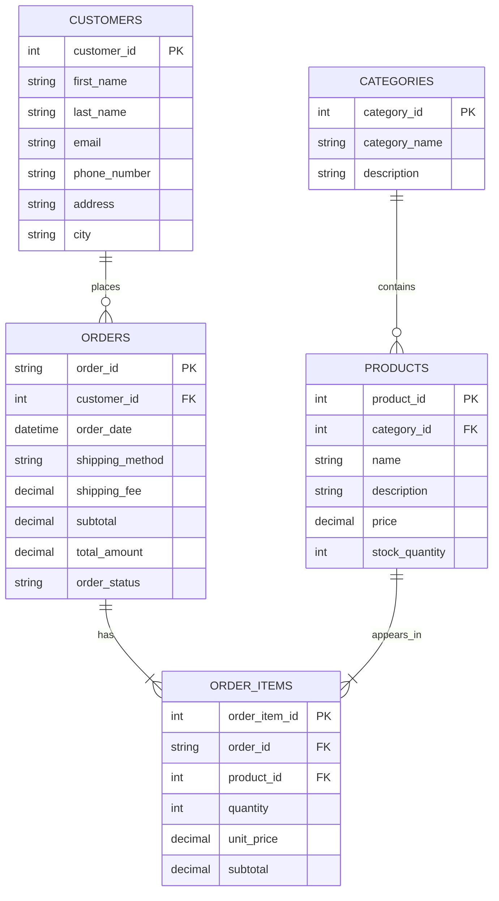

# Practice Checkout & E-Commerce Application

A modern, responsive E-Commerce web application built with **React** and **Vite**, featuring all 4 practical exercises:

1. **Practical Exercise 1**: Product Catalog & Interactive Shopping Cart (Laptop, Mouse, Keyboard, Monitor).
2. **Practical Exercise 2**: Customer Checkout Form with instant validation, shipping method selector, and dynamic total calculation.
3. **Practical Exercise 3**: Order Confirmation Receipt display with Order ID (`ORD-0001`), itemized breakdown, and status (`Pending`).
4. **Practical Exercise 4**: Database Design & ERD with 5 relational entities (`Customers`, `Categories`, `Products`, `Orders`, `Order_Items`).

---

## 🚀 Features

- **Product Catalog**: Filter by category (`All`, `Laptops`, `Accessories`), view pricing, star ratings, and real-time Add to Cart.
- **Cart Management**: Real-time quantity adjustment, item removal, free shipping progress bar, promo code engine (`DISCOUNT10`, `SAVE20`).
- **Customer Checkout**: Clean multi-step checkout form with phone country code selector, address fields, and multiple payment methods (Card, KHQR, COD).
- **Order Confirmation**: Printable digital receipt with auto-incrementing order number and item breakdown.
- **Database ERD**: Fully defined relational schema and Mermaid diagram included in `mermaid_erd.txt`.

---

## 🛠️ Tech Stack

- **React 18**
- **Vite**
- **Lucide React** (Modern SVG icons)
- **CSS3** (Responsive flexbox/grid, custom design system)

---

## 📦 Getting Started

### Prerequisites
- Node.js (version 18 or newer recommended)
- npm or yarn

### Installation
```bash
# Clone the repository
git clone https://github.com/morn-doek/Checkout.git

# Navigate to project directory
cd Checkout

# Install dependencies
npm install

# Start Vite development server
npm run dev
```

The application will be running at `http://localhost:5173`.

---

## 🗄️ Database Design (Exercise 4 ERD)


